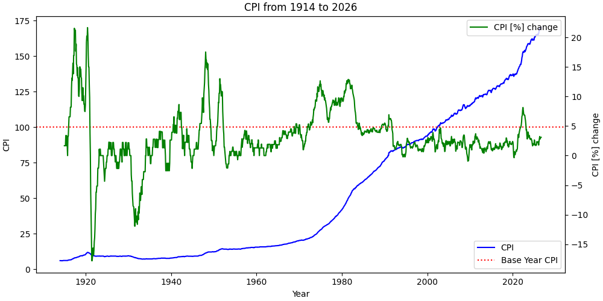

# FINE3300-2026-A2 Inflation Calculator

## Course: FINE 3300, By: Thinh Hoang

### Introduction
Welcome to my inflation calculator. This is a copy of the real web inflation calculator of Bank of Canada (there is a link under references section). In this write up, there is 3 sections of:
- Description
- Walkthrough of the Code
- CPI Graph Review

### Description
For this assignment, I have decided to choose the csv file as my primary information to extract and put on the panda data frame. In the repository, there will be 2 files,
- FINE 3300 Assignment 2.ipynb
- STATIC_INFLATIONCALC.csv
- README.md
- CPI_graph.png

Please ensure that the 2 files are together or they will not work. Since this project replicates the result of the Bank of Canada CPI Calculators. It required inputs:
1. Enter the Enter the price of the basket of goods ($)
2. Enter the first year (YYYY):
3. Enter the first month (MM):
4. Enter the second year (YYYY):
5. Enter the second month (MM):

Once all of the inputs are filled, the code will runs by it self and release the following information:
1. CPI rate for first year
2. CPI rate for second year
3. Basket Price for second year
4. Percentage Change 
5. Number of Years
6. Average Annual Inflation Rate
7. Graph for the CPI (It will be save as CPI_graph.png and shows in the code)

All of the information are similar to the one on the Bank of Canada website except for the month inputs and CPI graph. 

### Walkthrough of the Code
My code can be divided into 4 sections, which are:
1. Set up and Storing Data
2. Input
3. Calculations
4. Graph
5. Sample of the Code

#### 1. Set up and Storing Data
I have put the code in a .ipynb file to make markdown easier to read and divide up each sections. 
For the first part, I just import the matploblib, numpy, and pandas for the code. 
I also use the pandas to read the file and put it into a dataframe and rename it to read it easier.

#### 2. Input 
Since there are requirements for the input to have a validation check and make sure the code does not crash, the basket price required that the user must input a positive numbers and they must input a number or the code will not continue.
Similar to the basket price the function for date1 are similar as they can't be zero and must be a number. However, since they must be within the range of the CSV data. I have decided to code the first year from 1914 to 2026 as a possible input range, the month must be in between 1 - 12, and the month can't be September 2026 since that is the last data, hence there will not be and exchanging or calculation.
For date2 function, it is similar to the date1 function.
When I call for the function of date2, I also included the date1 tuples to pass secondary arguments

#### 3. Calculations
Since the first date column follows the order of YYYY-MM-DD, we can also see that the date is not required since it's always the first of the month. I use str[0:4] for the years and str[5:7] for the months, which i turn it into a integers to compare with the inputs which is also an integers
Then, the get_cpi1 and get_cpi2 functions are used to find the correct month and year for the CPI calculation
Now, the calculations follows the Bank of Canada calculations of:
1. Basket Price = Cost * CPI2/CPI1
2. Percentage Change = ((cpi2 - cpi1) / cpi1) * 100
3. Number of Years = year 2 - year 1
4. Average Annual Inflation Rate = ((cpi2 / cpi1) ** (1 / (year2 - year1)) - 1) * 100

After the calculation, it print out the result along with CPI for the first and second year.

#### 4. Graph
For the graph, after just plotting the graph without turning the dataframe into date, I noticed the X axis was fully black and assume that it was too much information of the date, month, and years which i use the pd.to_datetime for the code to recognize it as date rather than strings. After that, I plot the CPI first, and added label and title. Next, I focus on the secondary axis where is use ax.twinx. Since the data is a monthly rate, I want to change it a yearly rate change, hence shifting it by 12 and the calculation would be as follows: (first CPI/ CPI of 12 months before first CPI) - 1 to get the change in rate. Finally, I put an split line as the base level. I then add a legend and label for the graph.

#### 5. Sample of the Code

### CPI Graph Review
Below, I have included the graph for review.

As you can see, the CPI for the 1920 to 1970s saw a small increase where they climbed to around 25%. However, in the 1980s the CPI saw a dramatic increase, jumping from 25 to 100 in just 20 years. The trend continue until today where it sits at approximately 175. Another thing that intrigues me was the fact that the CPI change rate fall dramatically in 1921, it may seems weird but at the time for Canadians, it was after the first world wars, the post war prices climbed to the peak around 1920, after there was a boom and the rate drop showing a very wide swing for CPI % change (green line).

